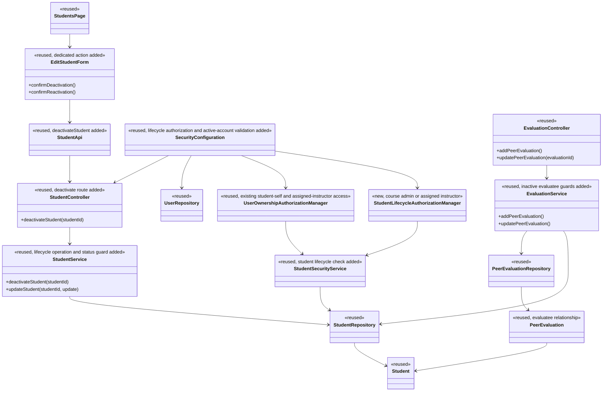

# STU Design

> Realizes: [UC-STU-deactivate-student](../requirements/use-cases.md#uc-stu-deactivate-student-the-course-admininstructor-deactivates-a-student)
> Depends on FRs: `FR-SEC-authorization`, `FR-SEC-deny-unauthorized`, `FR-SEC-active-account`
> See: [Use Cases](../requirements/use-cases.md), [Business Rules](../requirements/business-rules.md), [SRS](../requirements/software-requirements-specification.md), [Container and shared-foundation views](architectural-design.md)

## Overview

The student lifecycle lives in the shared foundation's `student` component. Deactivation is a dedicated action in the existing student-management view, with the account status change owned by `StudentService`; student records, team assignment, and submitted work are retained. The change also guards generic status updates, checks evaluatee status on peer-evaluation creation and edits, and validates account status on JWT requests. See the [Container Diagram](architectural-design.md#containers) and [Shared Foundation components](architectural-design.md#shared-foundation-components).

## Components & classes



- UI: [Students.vue](../../frontend/src/pages/students/Students.vue), [EditStudentForm.vue](../../frontend/src/pages/students/EditStudentForm.vue), [student API](../../frontend/src/apis/student/index.ts).
- Backend: [StudentController](../../backend/src/main/java/team/projectpulse/student/StudentController.java), [StudentService](../../backend/src/main/java/team/projectpulse/student/StudentService.java), [StudentRepository](../../backend/src/main/java/team/projectpulse/student/StudentRepository.java), [Student](../../backend/src/main/java/team/projectpulse/student/Student.java), [SecurityConfiguration](../../backend/src/main/java/team/projectpulse/security/SecurityConfiguration.java), [StudentInstructorAuthorizationManager](../../backend/src/main/java/team/projectpulse/security/authorizationmanagers/StudentInstructorAuthorizationManager.java), [StudentSecurityService](../../backend/src/main/java/team/projectpulse/student/StudentSecurityService.java), [UserRepository](../../backend/src/main/java/team/projectpulse/user/UserRepository.java), [EvaluationController](../../backend/src/main/java/team/projectpulse/evaluation/EvaluationController.java), [EvaluationService](../../backend/src/main/java/team/projectpulse/evaluation/EvaluationService.java), [PeerEvaluationRepository](../../backend/src/main/java/team/projectpulse/evaluation/PeerEvaluationRepository.java), and [PeerEvaluation](../../backend/src/main/java/team/projectpulse/evaluation/PeerEvaluation.java).

## Sequence

### Deactivate a student

```mermaid
sequenceDiagram
    actor Admin as Course admin / assigned instructor
    participant UI as Student edit form
    participant API as Student API
    participant Sec as SecurityConfiguration
    participant C as StudentController
    participant S as StudentService
    participant R as StudentRepository
    Admin->>UI: Choose Deactivate (UC step 3)
    UI-->>Admin: Show consequences and ask confirmation (step 4)
    alt Cancel (extension 4a)
        Admin->>UI: Cancel
        UI-->>Admin: Close warning; no request
    else Confirm (step 5)
        Admin->>UI: Confirm
        UI->>API: POST /students/{studentId}/deactivate
        API->>Sec: Send bearer token
        alt Caller is not authorized (extension 3a)
            Sec-->>UI: 403; no state change
        else Authorized
            Sec->>C: Authorized by StudentLifecycleAuthorizationManager
            C->>S: deactivateStudent(studentId)
            S->>R: Load student
            alt Student not found (extension 2a)
                R-->>S: No student
                S-->>UI: 404; no state change
            else Student already deactivated (extension 5a)
                R-->>S: Disabled student
                S-->>UI: 400; no state change
            else Student active
                S->>R: Set enabled=false; save
                R-->>S: Saved student; team assignment unchanged
                S-->>C: Student
                C-->>UI: Success Result (UC step 6)
                UI-->>Admin: Show deactivation confirmation
            end
        end
    end
```

### Reject access with an already-issued student token

```mermaid
sequenceDiagram
    actor Student
    participant Sec as JWT decoder / request security
    participant U as UserRepository
    Student->>Sec: Protected request with existing JWT
    Sec->>U: Load user by JWT userId and check account status
    alt Student is deactivated
        U-->>Sec: Account disabled
        Sec-->>Student: 401; deny protected request
    else Student is active
        U-->>Sec: Account enabled
        Sec-->>Student: Continue authorization
    end
```

### Guard peer-evaluation creation and edits

```mermaid
sequenceDiagram
    actor Evaluator as Active team member
    participant API as EvaluationController
    participant S as EvaluationService
    participant R as PeerEvaluationRepository
    alt Create evaluation (UC-EVA extension 4b)
        Evaluator->>API: POST /evaluations
        API->>S: addPeerEvaluation(new evaluation)
        S->>S: Check submission window and evaluatee.enabled
        alt Evaluatee is deactivated
            S-->>API: 400; do not save
        else Evaluatee is active
            S->>R: Save evaluation
            R-->>API: Saved evaluation
        end
    else Edit existing evaluation (UC-EVA extensions 7a/7b)
        Evaluator->>API: PUT /evaluations/{evaluationId}
        API->>S: updatePeerEvaluation(evaluationId, update)
        S->>R: Load stored evaluation and evaluatee
        R-->>S: Existing evaluation
        S->>S: Check evaluatee.enabled and stored submission window
        alt Evaluatee is deactivated
            S-->>API: 400; leave stored evaluation unchanged
        else Evaluatee is active and window is open
            S->>R: Save updated evaluation
            R-->>API: Updated evaluation
        else Submission window is closed
            S-->>API: 400; leave stored evaluation unchanged
        end
    end
```

The edit guard reads the existing `PeerEvaluation.evaluatee` relationship. Reactivation makes an edit eligible again through the same status check, but the existing submission-window check still applies.

## API contract

| Endpoint or job | Caller (who may) | Request | Success | Errors, by extension |
|---|---|---|---|---|
| `POST /api/v1/students/{studentId}/deactivate` | Course admin or instructor assigned to the student's course section | Student ID in path; no body | 200 `Result` with the deactivated student DTO | 401 disabled or invalid account token; 403 unauthorized caller (extension 3a); 404 student not found (extension 2a); 400 already deactivated (extension 5a) |
| `PUT /api/v1/students/{studentId}` (existing) | Student for self-updates; course admin or instructor assigned to the student's course section for lifecycle updates | Existing student DTO; `enabled` remains present | 200 `Result`; an authorized course admin or assigned instructor can reactivate through the existing flow | 401 disabled or invalid account token; 403 unauthorized caller; 400 for a generic `enabled: true → false` update; deactivation must use the dedicated action |
| `POST /api/v1/evaluations` (existing) | Active student evaluator on a team | Existing peer-evaluation fields | 200 `Result` with the saved evaluation | 400 if the evaluatee is inactive (extension 4b), the week is inactive/outside the submission window, or the evaluator has no team |
| `PUT /api/v1/evaluations/{evaluationId}` (existing) | Evaluator authorized to update that evaluation | Existing peer-evaluation fields | 200 `Result` with the updated evaluation | 400 if the evaluatee is inactive (extension 7a) or the stored evaluation's submission window is closed |

## Key decisions

- **Keep team assignment on deactivation.** This preserves the current roster and reporting context; removing the student would require a separate team mutation and would make reactivation semantics depend on reassignment.
- **Compose course-admin permission with the assigned-instructor check.** Reuse the section-assignment manager for instructors and explicitly allow course admins; a role-only instructor check would allow instructors assigned to another course section, while the assignment-only manager would exclude an unassigned course admin.
- **Reject new evaluations of inactive students and pause edits to existing ones.** Preserve existing records, block edits only while the evaluatee is deactivated, and resume edits after reactivation if the submission window remains open (BR-evaluation-target-active, BR-evaluation-editable-until-close).
- **Use the current team roster in course section reports, regardless of account status.** Hiding inactive students would change historical/report context; current-team membership, rather than account status, determines the roster.
- **Check account status on each bearer-token request.** The current JWT lasts two hours and signature/expiry validation alone cannot revoke it after deactivation. A database-backed check is chosen over waiting for expiry or using a stale cache, both of which would violate `FR-SEC-active-account`.
- **Keep deactivation separate from generic student editing without breaking reactivation.** The dedicated action and warning are the only path from enabled to disabled; generic updates reject that transition, but continue to allow disabled-to-enabled reactivation through the existing flow. Compose course-admin lifecycle authorization into the existing update route without broadening the shared user-ownership rule; retain student-self and assigned-instructor access. A dedicated reactivation endpoint was rejected as unnecessary scope expansion.

## Data model

No schema change. Reuse the existing `Student.enabled` account state and team relationship; preserve existing weekly activity reports and peer evaluations. See the SRS [Business Domain Model](../requirements/software-requirements-specification.md#business-domain-model).

## Reuse & cross-cutting

Reuse the shared `student` foundation component, the `Result` envelope, existing authorization patterns scoped to course sections, `UserRepository`, and the current evaluation/report services. `StudentLifecycleAuthorizationManager` checks that the caller is the student's course admin or an instructor assigned to her course section; compose it with `UserOwnershipAuthorizationManager` on the existing update route so student-self updates remain available. The immediate account revocation check extends shared JWT validation and must land as a separate trunk-first change before the STU leaf work. The existing peer-evaluation report already builds its roster from current team membership; keep that behavior and add coverage for deactivated members.

## Tests

| Use case, flow | Level (unit / integration) | Asserts |
|---|---|---|
| Main success: assigned instructor and course admin deactivate an active student | Integration | Account becomes disabled; team assignment and prior submissions remain; response succeeds |
| Extension 2a: student no longer exists | Integration | 404; no state change |
| Extension 3a: unauthorized instructor or student | Integration | 403; account remains active |
| Extension 4a: actor cancels at warning | Frontend integration (Cypress) | Warning closes; no request is sent; account remains active |
| Extension 5a: student is already deactivated | Unit and integration | Clear 400 response; no second state change |
| Extension 4b: inactive student is submitted as a new evaluation target | Unit and integration | New peer evaluation is rejected; no record is created |
| Extension 7a: existing evaluation is edited while its evaluatee is deactivated | Unit and integration | Edit is rejected without changing the evaluation |
| Extension 7b: evaluatee is reactivated before the window closes | Unit and integration | Edit is accepted again; a closed window remains locked |
| Course section's report includes inactive current-team member | Unit | Roster includes the student regardless of status; only existing submissions contribute scores |
| Existing JWT after deactivation | Security integration | Next protected request returns 401; new login is rejected |
| Generic update attempts active-to-disabled transition | Integration | Update returns 400 and account stays enabled |
| Existing reactivation path | Integration and frontend integration | Course admin and assigned instructor can reactivate through the generic update after confirmation; account is enabled and team assignment is retained |

## Open questions / risks

The status lookup on bearer-token validation adds a database read to protected requests. It is not cached so deactivation takes effect on the next request; verify this behavior with an integration test.
